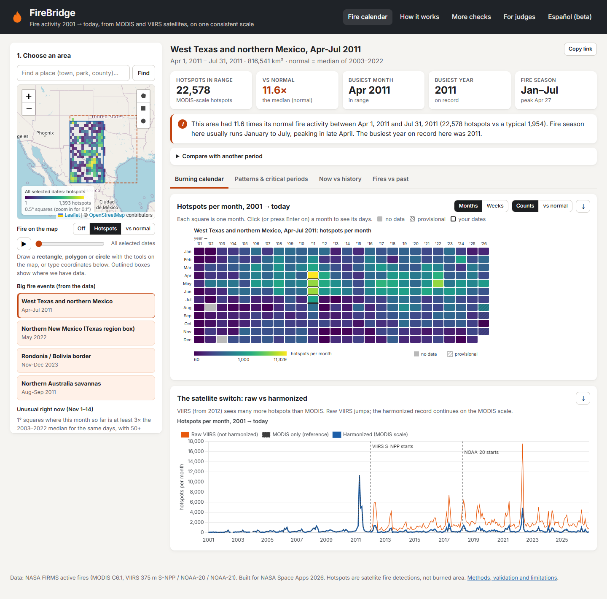
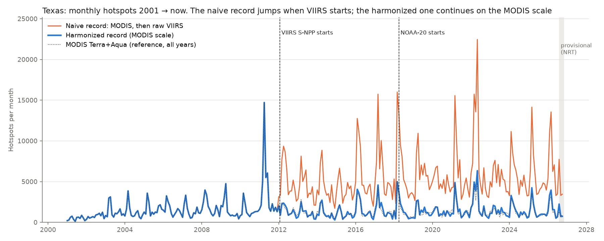

# FireBridge: one consistent fire record from 2001 to today

**Live site:** TBD (Hugging Face Space, see [docs/DEPLOY.md](docs/DEPLOY.md)) ·
**Demo video (30 s):** TBD (YouTube, unlisted) ·
NASA Space Apps 2026 challenge: *Harmonization of MODIS and VIIRS Hot Spots*

FireBridge joins two generations of NASA fire satellites into **one burning activity calendar**
for any area you choose. Draw an area on the map (or type coordinates), pick dates, and see:

- a **burning calendar**: hotspots per month for every month since 2001, with accessible
  color ramps (counts, or each month vs its normal), grey for missing data, hatched for
  provisional data
- **which periods of the year see the most fire**: typical monthly activity, the fire season,
  the highest-risk months and how often each month has been unusually busy
- **which years had the most burning**, ranked
- **how this month compares with the historical median** for the same days, with live
  near-real-time data
- a plain-language summary for responders, and downloads: **the hotspots themselves (CSV)**,
  the daily analytics table (CSV) and every chart as PNG



## The problem

Satellites have mapped active-fire hotspots for more than 20 years, but the record is split.
**MODIS** (Terra and Aqua, 1 km pixels) covers 2000 onward; NASA plans to end MODIS data
collection in 2027. **VIIRS** (S-NPP from 2012, then NOAA-20 and NOAA-21, 375 m pixels) sees
smaller and cooler fires, so it reports far more hotspots for the same fires: on our test years
raw VIIRS counts are **+659.69%** higher than MODIS Aqua. Put the two records end to end and fire
activity seems to explode in 2012. It didn't; the instrument changed.

## What we did

1. **Harmonize.** We translate VIIRS counts to "MODIS-equivalent" hotspots with **quantile
   mapping**, learned from 2012–2018 when MODIS Aqua and VIIRS S-NPP flew the same early
   afternoon / after-midnight orbit, separately for each region, land-cover type (MODIS
   MCD12Q1) and day/night; then scaled to the full Terra + Aqua record. Days with several VIIRS
   satellites are averaged, not added. Before 2012 the record is MODIS itself.
2. **Validate honestly** on data the method never saw (below), against the obvious quick fix,
   one global ratio.
3. **Build the app** on the harmonized record: FastAPI + DuckDB over Parquet, a plain HTML/JS
   front end (Leaflet, D3, Chart.js), and an hourly live FIRMS feed for the current month.
   **Missing data is shown as missing, never as zero fire.**

The full method, every validation number and the limitations are on the site's
**How it works** page (`/methods`); the same text is in [docs/methods_text.md](docs/methods_text.md).

## Validation (all numbers from [results/metrics.json](results/metrics.json))

Monthly regional totals vs real MODIS Aqua counts.

**Test years 2019–2026** (fitted on 2012–2018 only)

| Method | R² | Bias | RMSE (hotspots / month) |
|---|---|---|---|
| Raw VIIRS | −60.32 | +659.69% | 63,146 |
| One global ratio | 0.9774 | −0.86% | 1,212 |
| **FireBridge (quantile mapping)** | **0.9855** | **−0.88%** | **971** |

**NOAA-20, a satellite never used in fitting**

| Method | R² | Bias | RMSE |
|---|---|---|---|
| Raw VIIRS | −59.38 | +651.35% | 62,479 |
| One global ratio | 0.9775 | −1.95% | 1,206 |
| **FireBridge** | **0.988** | **−2.83%** | **882** |

Where it struggles: in the Amazon our monthly error is higher than one global ratio's, even
though our total is closer; Texas runs slightly high. Details and reasons are in the
limitations section of the methods page.



## NASA data used

- **NASA FIRMS active fires, MODIS Collection 6.1** (Terra, Aqua): archive MCD14ML
  (doi:10.5067/FIRMS/MODIS/MCD14ML) and near-real-time MCD14DL
  (doi:10.5067/FIRMS/MODIS/MCD14DL.NRT.0061). The 2001–2011 backbone of the record and the
  reference VIIRS is translated to.
- **NASA FIRMS VIIRS 375 m active fires, Collection 2**: S-NPP (VNP14IMGT,
  doi:10.5067/FIRMS/VIIRS/VNP14IMGT_NRT.002), NOAA-20 (VJ114IMGT,
  doi:10.5067/FIRMS/VIIRS/VJ114IMGT_NRT.002), NOAA-21 (VJ214IMG, doi:10.5067/VIIRS/VJ214IMG_NRT.002).
  The record from 2012; NOAA-20 doubles as an independent test; the live feed uses the NRT
  streams through the FIRMS API.
- **MODIS Land Cover Type MCD12Q1 v061** (via NASA AppEEARS, doi:10.5067/MODIS/MCD12Q1.061):
  the harmonization is learned separately for forest, shrubland, savanna, grassland and cropland.

How the data shaped the project: the size of the MODIS-to-VIIRS jump made a correction
mandatory; the overlap years made it learnable; the land-cover data showed that one ratio
doesn't fit every landscape; FIRMS missing-data days led to treating gaps as unknown rather
than zero; and the end of MODIS in 2027 is why a consistent bridge matters now.

## Run it locally

```
git clone https://github.com/jonahgigi534-wq/NASA-SPACEAPPS-VIIRS
cd NASA-SPACEAPPS-VIIRS
python -m venv .venv && .venv/bin/activate      # Windows: .venv\Scripts\activate
pip install -r requirements.txt
```
Get the app data (4 files, about 530 MB) into `data/app/`, either from our public dataset
<https://huggingface.co/datasets/JonathanGigi/SPACEAPPS-DATA> or by setting
`APP_DATA_URL=https://huggingface.co/datasets/JonathanGigi/SPACEAPPS-DATA/resolve/main/`
(the app downloads them at startup). Then:
```
uvicorn app.main:app
```
and open http://127.0.0.1:8000. Optional: put `FIRMS_MAP_KEY=...` in `.env` and run
`python -m pipeline.live` for the latest days. No data? `python scripts/make_synthetic_app_data.py`
makes fake data in the same format. Tests: `pytest tests/ -q`. Rebuilding the data from the raw
FIRMS archives: see the `Makefile` and `pipeline/`.

| Part | Where |
|---|---|
| Data pipeline, harmonization, validation | `pipeline/`, `results/` |
| API and analytics | `app/main.py`, `app/analytics.py` (API shapes: `docs/CONTRACTS.md`) |
| Website | `app/static/` |
| Live FIRMS feed | `pipeline/live.py` |
| Deploy | `Dockerfile`, `scripts/deploy_space.py`, `docs/DEPLOY.md` |
| Demo video | `scripts/record_demo.py`, `docs/video_script.md` |

## Limitations (short version)

Hotspots are detections of active fire at the moment of an overpass, not burned area; clouds
and smoke hide fires. Recent data is provisional. The MODIS reference itself drifts after about
2022 as Terra and Aqua leave their orbits. FRP uses one simple conversion and was not separately
validated. The three study regions are rectangles. Full list on the methods page.

## Use of AI

We used Claude Code (Anthropic) as a coding assistant for the pipeline, the API, the website,
the tests, the deploy and video scripts, and drafts of the documentation. The team reviewed and
ran everything. All numbers come from the pipeline's outputs on NASA data; no figures, images or
video were generated by AI. Details: [docs/AI_USE.md](docs/AI_USE.md).

## Team

TBD
